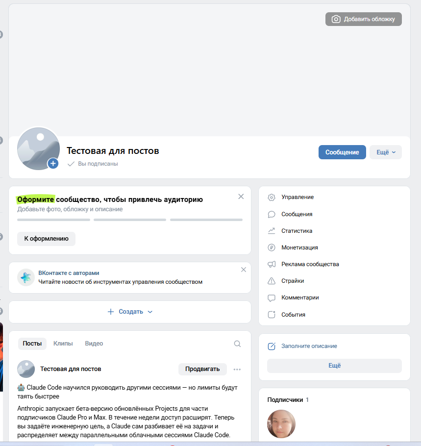
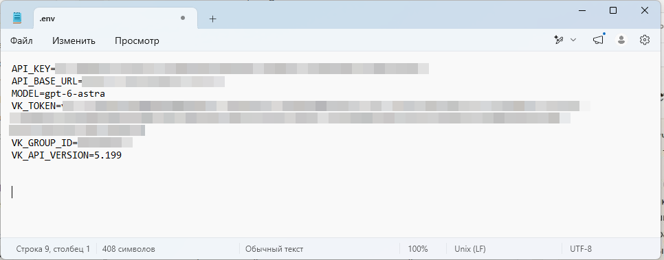
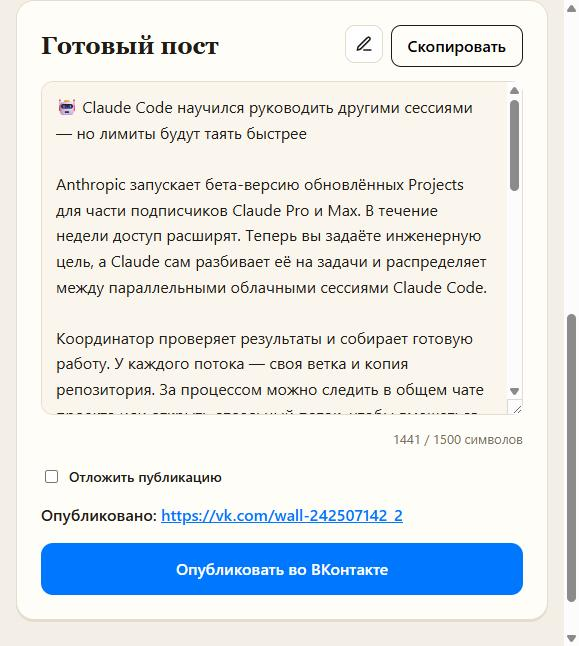
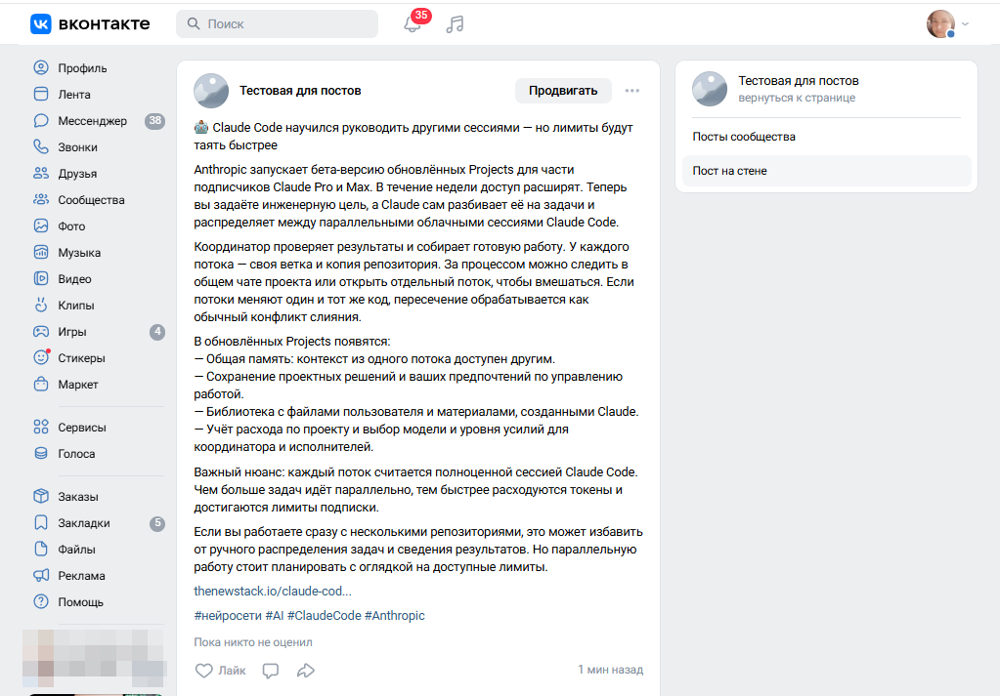

# ДЗ INVP03 — генератор постов с публикацией во ВКонтакте

**Студент:** Евгения Толстых
**Вариант:** 1 (базовый — повтори за экспертом), выполнен полностью; отложенная публикация из «дополнительно» тоже сделана
**Дата:** 22.10.2026

| | |
|---|---|
| Репозиторий | https://github.com/JaneEva08/vk-news-post-generator |
| Опубликованный пост | https://vk.com/wall-242507142_2 |
| Среда разработки | Claude Code (вместо OpenCode) |

> Я не новичок: уже год прохожу курсы в Zerocoder. На интенсив пошла, потому что понравилась тема, — и этот кейс пойдёт в копилку моего портфолио. Поэтому делала не только по шагам урока, а как для реального проекта: адаптировала генератор под свою задачу, вынесла секреты в `.env`, выложила код на GitHub и проверила работу как тестировщик.

---

## 1. Что сделано

Сверх задания генератор адаптирован под мою задачу (это не отдельная функция, а другой источник для поста): пост пишется не по карточке товара, а **по новости про нейросети** — по ссылке или вставленным текстом. Я веду каналы про AI, и такой генератор мне нужен в работе.

| Возможность | Статус |
|---|---|
| Генерация поста нейросетью через Proxy API | ✅ |
| Два режима ввода: «По ссылке» и «Текстом» | ✅ |
| Четыре тона: экспертный, дружелюбный, короткий, с юмором | ✅ |
| Правила поста в `voice.md` — меняются без кода | ✅ |
| Редактирование (карандаш) и копирование | ✅ |
| Публикация в сообщество ВК — «Опубликовать сейчас» | ✅ проверено на реальном сообществе |
| Отложенная публикация (дата и время) | ✅ |
| Подтверждение перед публикацией | ✅ |

**Стек:** Python, Flask, `openai` (клиент Proxy API), `requests`, `beautifulsoup4`, `python-dotenv`; HTML, CSS, JavaScript.

**Как работает публикация:** сайт отправляет в ВК метод `wall.post` с текстом, ID сообщества и токеном. Для отложенного поста добавляется `publish_date` — ВКонтакте сам публикует запись в нужное время.

## 2. Безопасность

- Токен ВК, ID сообщества и ключ Proxy API хранятся только в `.env`.
- `.env` в `.gitignore`; история коммитов проверена — секретов нет.
- В репозитории только `.env.example` с пустыми значениями.
- На скриншотах все ключи скрыты.

## 3. Возникли ли сложности при подключении?

Да, все решены:

1. **Ошибка 429 от нейросети** (сервис перегружен). Добавила понятные сообщения на русском для типовых ошибок: перегрузка, неверный ключ, нет доступа, модель не найдена, таймаут.
2. **ID сообщества** был записан в `.env` как `club…`. Сайт теперь сам оставляет только число.
3. **Лишняя рубрика в посте.** Нейросеть вставляла подпись «Что это даёт читателю» — приняла название пункта из `voice.md` за готовый текст. Переписала правила.
4. **Картинки к постам.** Хотела публиковать посты с картинками, но ключом сообщества ВКонтакте не даёт загружать фото на стену (ошибка 27), нужен ключ пользователя. Через новый VK ID быстро получить его не удалось — функцию убрала и оставила на доработку.

## 4. Всё ли удалось настроить и запустить?

Да. Пост по реальной новости ([The New Stack](https://thenewstack.io/claude-code-parallel-projects/) о параллельных проектах в Claude Code) сгенерирован и опубликован в тестовом сообществе кнопкой «Опубликовать во ВКонтакте»: 1441 символ, текст на стене совпадает с генератором слово в слово.

**Проверки (опыт тестировщика пригодился):**

- **Сервер — 13 сценариев:** пустая ссылка, не-ссылка, пустой и слишком короткий текст, неизвестный тон, незаполненный `.env`, пустой пост, нет настроек ВК, отложка в прошлое и с неверной датой, публикация и отложка (с подменой ответа ВК).
- **Браузер — 11 сценариев:** ошибки пустых полей, переключение вкладок, выбор тона, карандаш, копирование, переключатель отложки, мобильная версия (375 px, без горизонтальной прокрутки).
- **Реальные ссылки:** закрытый от парсинга сайт (VentureBeat) — сайт корректно предлагает вкладку «Текстом»; The New Stack — пост сгенерирован.

## 5. Скриншоты

**1. Сообщество ВКонтакте, куда публикуется пост**

**2. Настройки интеграции — `.env`, ключи и токен скрыты**

**3. Генератор с готовым постом и подтверждением «Опубликовано»**

**4. Стена сообщества с опубликованным постом**

## 6. Что дальше

- Картинки к постам через ключ пользователя (VK ID).
- История публикаций с защитой от повторной отправки.
- Публикация в Telegram.
